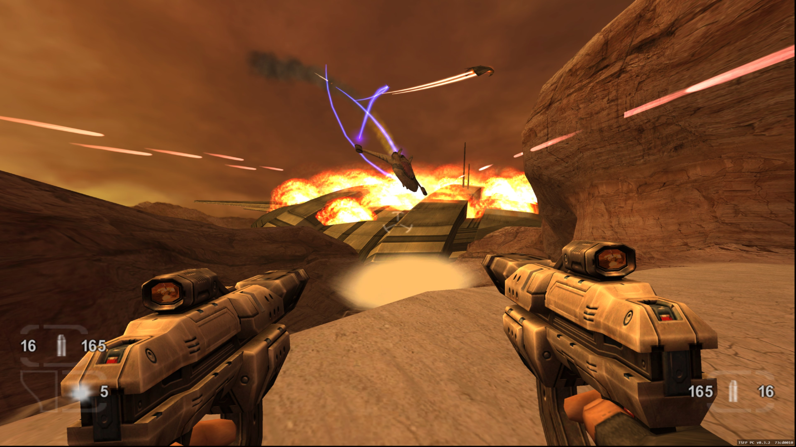
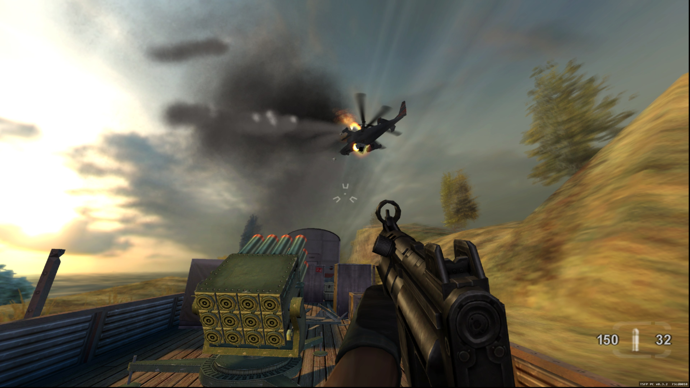
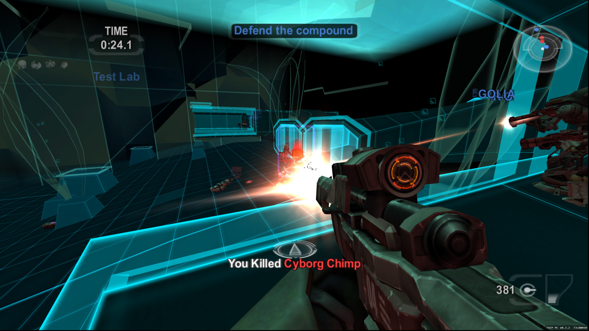
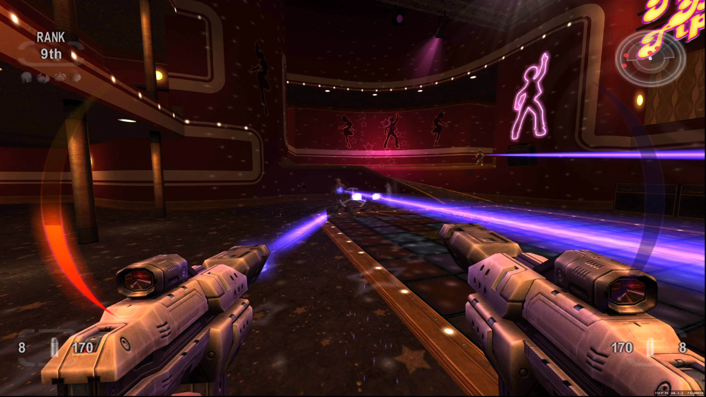

# 

Keyboard & mouse · 4K & ultrawide · Custom controls · Online multiplayer (Windows)

Direct ZIP downloads of the latest stable launcher &middot; <a href="https://github.com/TheDoffman/timesplitters-future-perfect-pc/releases/latest">Release notes &amp; checksums</a>

**[Install & play](#start-playing)** · [Launcher guides](#guides--support) · [Multiplayer](docs/players/multiplayer.md) · [Build from source](docs/development/building.md)

Windows 10/11 x64 · Native Apple Silicon Mac · Experimental port · Supported US Xbox game required

<table>
  <tr>
    <td width="50%"></td>
    <td width="50%"></td>
  </tr>
  <tr>
    <td width="50%"></td>
    <td width="50%"></td>
  </tr>
</table>

In-game screenshots as of v0.3.2

> [!IMPORTANT]
> You need your own supported **US Xbox ISO or extracted game data**. Import it through the launcher.
> Original game files are not included. Neither version needs an emulator.

##  Start playing

Windows and Mac use the same installation steps:

| Step | Installation |
| :---: | --- |
| **01** | **Download the launcher:** [Windows x64](https://github.com/TheDoffman/timesplitters-future-perfect-pc/releases/latest/download/TimeSplitters-Launcher-windows-x64.zip) or [Mac (Apple Silicon)](https://github.com/TheDoffman/timesplitters-future-perfect-pc/releases/latest/download/TimeSplitters-Launcher-macos-arm64.zip). The download starts directly; you can also use the buttons above. |
| **02** | **Extract and open.** Extract the whole ZIP to a writable folder. On Windows, open **TimeSplitters Launcher.exe**, keeping `Bin` and `Support` with it. On Mac, open **TimeSplitters Launcher.app**, keeping its `Support` folder beside it. |
| **03** | **Install the game runtime.** Keep **Update channel → Stable**, then choose **Install release**. The launcher downloads and verifies the latest available game build for your platform. Choose a preview only when opting into testing. |
| **04** | **Import your game once.** Choose **Locate ISO**, or **Use extracted files** for a folder containing `default.xbe`, `pak` and `xmv`. |
| **05** | **Press Play Game.** The launcher minimizes while the game runs and returns when you finish. |

**Next time:** open the launcher and choose **Play Game**. Installed play remains
available offline. Use **Check updates → Update release** to install a newer game
build when available. Launcher and game versions are separate.

<strong>Launcher preview</strong>

Launcher v1.4.0 interface preview with illustrative installation data.
**Stable** is selected, matching the setup instructions above.

<strong>System requirements, channels and keeping your saves</strong>

- **Windows:** Windows 10/11 x64 with .NET Framework 4.8.
- **Mac:** Apple Silicon (M1 or newer). The launcher targets macOS 12+; the
  current shared Vulkan game renderer requires macOS 26+. See the
  [Mac guide](docs/players/macos.md) for the legacy OpenGL fallback on older systems.
- Your supported **US Xbox game**, title ID `45410066`; [exact executable hash](docs/development/building.md#inputs-and-generated-files).
- Internet access for the initial runtime download; about **5 GB** for the game,
  plus space for update staging, rollback and any optional textures.
- **Stable** is the default game channel. Choose **Preview**, then **Beta** or a named feature under **Testing track** for opt-in testing. Each track follows its own updates in launcher 1.3.0+. See [release channels](docs/release/releasing.md).
- Keep the whole installation together, especially `Data`, `Settings`, `Saves`
  and the launcher's recovery files. Normal updates preserve existing data,
  settings and saves.

Published builds do not require Python, Git or developer tools. The Mac launcher
includes .NET and does not need CrossOver or the .NET SDK.

### Platform status

This is an experimental port. Full campaign completion and complete rendering
and audio fidelity remain unverified. See [measured progress](docs/project/STATUS.md).

| Platform | Support and known limits |
| --- | --- |
| **Windows 10/11 x64** | Keyboard and mouse, graphics settings and experimental Online/LAN multiplayer. See the [Windows launcher guide](docs/players/launcher.md), including [startup security prompts](docs/players/launcher.md#windows-security-prompts-at-startup). |
| **Mac (Apple Silicon)** | Native launcher and game; Intel Macs are unsupported. Save/load remains unverified; movie playback and multiplayer remain unfinished. The app is not notarized, so startup may require the [Mac installation and recovery guidance](docs/players/mac-launcher.md#shared-behavior-and-distribution). See [Mac controls and source builds](docs/players/macos.md) and [remaining Mac work](docs/project/MAC_PORT_BACKLOG.md). |

##  PC features

| Feature | Details |
| --- | --- |
| **Keyboard and mouse** | Direct aiming, customizable bindings, mouse-driven menus and input prompts that follow your controls. |
| **Widescreen** | 1080p, 1440p, 4K and ultrawide support, with adjustable field of view. |
| **High frame rate** | Original 60 FPS by default; compatible game builds offer opt-in [120/180/240 FPS beta settings](docs/analysis/native-high-refresh.md). |
| **Launcher** | Game installation, updates, repair, rollback and settings. |
| **Online multiplayer** | Player-hosted Online and LAN matches with bot support. Windows only. |
| **Extras** | Optional [Discord Rich Presence](docs/players/discord-presence.md), FPS overlays and local crash diagnostics. |

Availability depends on your platform and installed game version. Check the
launcher's **Release notes**, [platform status](#platform-status) and
[measured progress](docs/project/STATUS.md) for support and known limits.

## Multiplayer

On Windows, choose **Online / System Link → Online** to host or join a match,
or **System Link** for LAN play. Everyone needs matching game builds and data.
Online hosts need port forwarding; guests join using the host's invitation.
Follow the [multiplayer guide](docs/players/multiplayer.md) for setup, ports and bots.

Online is experimental;
Story co-op and native Mac multiplayer are not supported yet.

## Enhanced textures

The partial texture overhaul is an optional launcher download for Windows and
Mac.
**Classic** textures remain the default.

When the optional pack is available, use **Game settings → Graphics & resolution
→ Check texture downloads**, then **Download / update textures**. Enable and save
**Use enhanced textures (Beta)** to use it on future launches. See the
[texture guide](docs/textures/textures.md) for availability, coverage and known issues.

##  Guides & support

[All documentation](docs/README.md) · [Repository layout and naming](docs/development/repository-layout.md)

| Playing | Development |
| --- | --- |
| [Windows launcher](docs/players/launcher.md) | [Build from source](docs/development/building.md) |
| [Mac launcher](docs/players/mac-launcher.md) | [Native Mac build](docs/players/macos.md) |
| [Controls & display](docs/players/windows-settings.md) | [Shared Windows/Mac architecture](docs/development/shared-platform.md) |
| [Multiplayer](docs/players/multiplayer.md) | [Release publishing](docs/release/releasing.md) |
| [Textures](docs/textures/textures.md) | [Isolated gameplay testing](docs/development/testing-profile.md) |
| [Crash reports](docs/players/windows-crash-logger.md) | [Repository map for agents](docs/agent-context/README.md) |

**[Report a bug](https://github.com/TheDoffman/timesplitters-future-perfect-pc/issues/new?template=01-bug-report.yml)**
with your installed versions, platform and steps to reproduce. The launcher's
**Diagnostics** page provides local reports and logs; nothing uploads automatically.
Keep personal saves and game data private.

Suggest improvements in **[Ideas](https://github.com/TheDoffman/timesplitters-future-perfect-pc/discussions/categories/ideas)**.
To contribute, read the [contributing guide](CONTRIBUTING.md),
[project rules](AGENTS.md) and [code of conduct](CODE_OF_CONDUCT.md).
Report security vulnerabilities privately using the [security policy](SECURITY.md).

## Support the project

Enjoying the project? [Buy me a coffee on Ko-fi](https://ko-fi.com/thedoffman)
to support continued work on TimeSplitters and the discoveries shared along the way.
Thank you for being part of the project!

## Credits & license

The project statically recompiles the Xbox executable into native code; it does
not recover the original C/C++ source. The pinned runtime source is bundled with its credits and licenses, and the [independent tooling replacement](docs/development/independent-runtime.md) is in progress. See [bundled runtime source](docs/development/building.md#bundled-runtime-source) for setup verification and remaining dependencies.

Original project code and documentation are licensed under **GPL-3.0-only**,
except where stated otherwise. See [LICENSE](LICENSE) and [NOTICE](NOTICE).
When distributing GPL-covered binaries, provide corresponding source and build
instructions and preserve the required notices. Upstream and third-party
components retain their own [licenses and credits](LICENSES/README.md).

**This license does not cover the original TimeSplitters game or its assets.**
You must supply your own supported game files. Original game data, generated
game code, personal settings and saves are not included in this repository.
