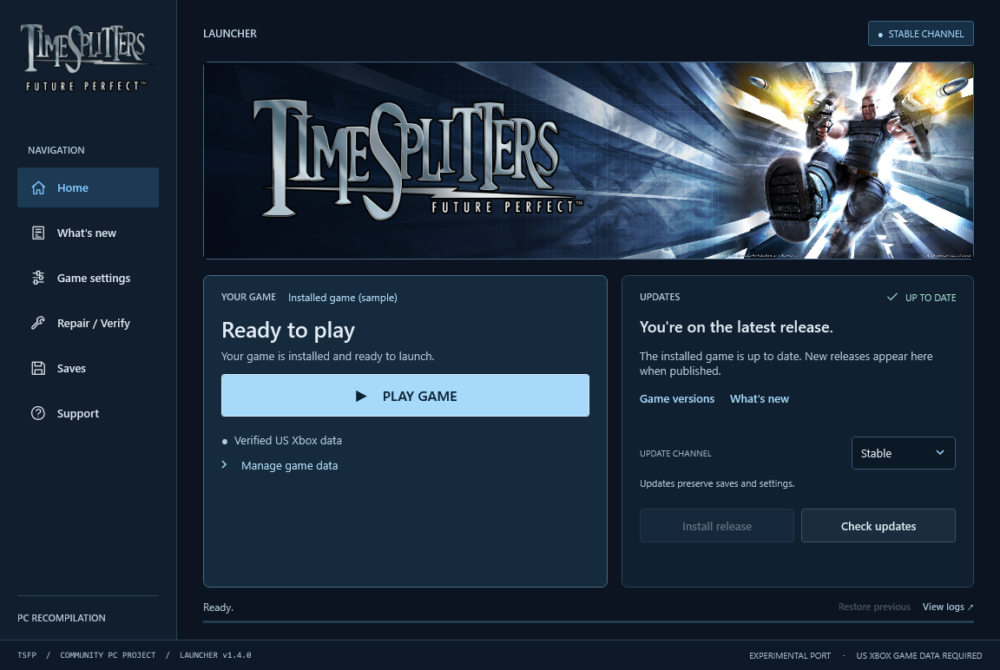

<div align="center">

# TimeSplitters: Future Perfect

Direct mouse aiming · 4K & ultrawide · Custom controls · Windows Online & LAN

<a href="https://github.com/TheDoffman/timesplitters-future-perfect-pc/releases/latest"></a>
<a href="https://github.com/TheDoffman/timesplitters-future-perfect-pc/releases/latest"></a>

<sub>Direct ZIP downloads · Automatically follow the latest stable launcher release · <a href="https://github.com/TheDoffman/timesplitters-future-perfect-pc/releases/latest">Release notes & checksums</a></sub>

**[Windows setup](#windows)** · **[Mac setup](#mac-apple-silicon)** · [Launcher guides](#guides--support) · [Multiplayer](docs/multiplayer.md) · [Build from source](docs/building.md)

<sub>Windows 10/11 x64 · Native Apple Silicon Mac · Experimental port · Supported US Xbox game required</sub>

</div>



<p align="center"><sub>Launcher v1.2.18 interface preview. The game version and channel shown are sample data; choose <strong>Preview</strong> to install current game prereleases.</sub></p>

> [!IMPORTANT]
> You need your own supported **US Xbox ISO or extracted game data**. Import it
> through the Windows launcher, or follow the [Mac game-data setup](docs/macos.md).
> Original game files are not included. Neither version needs an emulator.
> Windows has a downloadable game runtime; Mac currently requires a source build.

## Start playing

Use the Windows or Mac download button above to get the latest stable launcher
ZIP for your computer, then follow its setup steps below. See the
[latest launcher release](https://github.com/TheDoffman/timesplitters-future-perfect-pc/releases/latest)
for release notes and checksums.

### Windows

| Step | Installation |
| :---: | --- |
| **01** | **[Download the Windows launcher](https://github.com/TheDoffman/timesplitters-future-perfect-pc/releases/latest).** On the release page, choose **Download Windows x64**. |
| **02** | **Extract and open.** Extract the whole ZIP to a writable folder, keeping `Bin` and `Support` together. Open **TimeSplitters Launcher.exe**. |
| **03** | **Install the game runtime.** Set **Update channel → Preview**, then choose **Install release**. The launcher downloads and verifies the published PC runtime. |
| **04** | **Import your game once.** Choose **Locate ISO**, or **Use extracted files** for a folder containing `default.xbe`, `pak` and `xmv`. |
| **05** | **Press Play Game.** The launcher minimizes when the game window appears and returns when you finish. |

**Next time:** open **TimeSplitters Launcher.exe → Play Game**. Installed play
remains available offline.

New Windows game builds include a dedicated TSFP game icon. Existing game
downloads receive it with a new game release; a launcher-only update keeps
the installed game executable. See the [game icon build notes](docs/windows-launcher.md#windows-game-icon).

Launcher v1.2.14 adds recovery when Windows interrupts startup, with **Retry**,
**Open launcher folder** and **View logs**. See the
[Windows security prompt guidance](docs/launcher.md#windows-security-prompts-at-startup).

<details>
<summary><strong>System requirements, channels and keeping your saves</strong></summary>

- **Windows 10/11 x64** with **.NET Framework 4.8**.
- Your supported **US Xbox game**, title ID `45410066`; [exact executable hash](docs/building.md#inputs-and-generated-files).
- Internet access for the initial runtime download; about **5 GB** for the game,
  plus space for update staging, rollback and any optional textures.
- **Preview** includes published game prereleases. **Stable** excludes them.
  Launcher and game versions are separate.
- Keep the whole installation together, especially `Data`, `Settings`, `Saves`
  and the launcher's recovery files. Normal updates preserve existing data,
  settings and saves.

Python, Git and Visual Studio are not required to play the published Windows build.

</details>

### Mac (Apple Silicon)

The native **Mac launcher is available now** for Apple Silicon (M1 or newer).
It shares the Windows launcher's pages, settings, release notes and diagnostics.
The launcher app includes .NET; it does not need CrossOver, Python or the .NET SDK
to open. Intel Macs are not supported by this native build.

> [!IMPORTANT]
> The Mac launcher download does **not** include the game runtime. A published
> Mac game package is not available yet. Build the native game from source using
> the guide below; the Mac launcher cannot install or run the Windows game ZIP.

| Step | Installation |
| :---: | --- |
| **01** | **[Download the Mac launcher](https://github.com/TheDoffman/timesplitters-future-perfect-pc/releases/latest).** On the release page, choose **Download Mac (Apple Silicon)**. Extract the whole ZIP and keep **TimeSplitters Launcher.app** beside its **Support** folder. |
| **02** | **Set up the native game.** Follow the [Mac source-build guide](docs/macos.md) for developer tools, your supported US Xbox game data and the native build. Keep `default.xbe`, `pak` and `xmv` together in the checkout's `private/game` folder. |
| **03** | **Open the launcher for your checkout.** Use the command below, replacing both example paths with your extracted app and checkout folders. Then choose **Play Game**. |

```sh
open '/path/to/TimeSplitters Launcher.app' --args --root '/path/to/timesplitters-future-perfect-pc'
```

For an existing native checkout, `./Play-Native-Mac.command` is also available;
`./Play-Native-Mac.command --check` checks prerequisites without starting the game.

If the release launcher reports a read-only `AppTranslocation` path, follow the
[Mac launcher folder recovery instructions](docs/mac-launcher.md#shared-behavior-and-distribution).
Keep the `.app` and `Support` folder together.
Development checkouts disable release installation and self-updates to preserve
your source and local builds. Keep `private/game`, `private/saves`, `config` and
`private/native-settings` when updating the checkout.

The launcher targets **macOS 12+**. The current shared Vulkan game renderer
requires **macOS 26+**; the [Mac guide](docs/macos.md) documents the legacy OpenGL
fallback for older systems. The app currently uses ad-hoc signing; Developer ID
signing, notarization and clean-machine installation remain pending.
Mac launcher v1.2.19 has a reported damaged-app rejection and an unsealed app
bundle; see [the signing correction and one-time migration](docs/launcher-releases.md#mac-application-signing-and-the-v1219-migration)
for the fix status and remaining Gatekeeper limitations.

**Controls:** click inside gameplay to capture the mouse, use **WASD** to move,
and **Escape** to pause and release it. **F2** opens keyboard, mouse and graphics
settings; **F11** toggles fullscreen. Use **Fn** with function keys if macOS
reserves them. See the [full Mac controls](docs/macos.md) and
[native launcher guide](docs/mac-launcher.md).

**Current Mac status:** native menus, movement, mouse aiming, firing and
pause/resume have been checked, with additional bounded first-mission, Khallos
and Mansion scene checks recorded in [measured progress](STATUS.md).
Rendering and simulation use the original **60 FPS / 60 Hz** path on both hosts.
Full campaign completion, save/load and complete rendering/audio fidelity remain
unverified. Movie playback, native multiplayer and standalone game delivery
remain unfinished. [Track remaining Mac work →](MAC_PORT_BACKLOG.md)

## PC features

Feature availability depends on the platform and installed game build. The
Windows details below do not establish Mac parity; see [current Mac status](#mac-apple-silicon).

Current source uses fixed 60 FPS on Windows and Mac. Experimental interpolation,
prediction, uncapped pacing and automatic monitor refresh controls have been
removed. Older timing preferences are ignored by the runtime and normalized
when launcher settings are saved; unrelated preferences remain intact.
Your desktop refresh rate stays unchanged. Published builds require an update
containing these changes.

Upcoming launcher source adds [native frame-rate selection](docs/launcher.md#native-frame-rate-selection-upcoming-launcher-update):
60 FPS (Original), 120 FPS (Beta), and 144 FPS (Beta). The higher targets require
an accompanying game build with the new native high-refresh runtime; older
published games do not gain high-FPS support from the launcher alone.


Optional Windows [Discord Rich Presence](docs/discord-presence.md) shows the
current game mode and session timer. Enable it in **Game settings → Discord**
with the Discord desktop app running. Fresh installs leave it off.

<table>
<tr>
<td width="50%" valign="top"><strong>Mouse aiming</strong><br>Direct camera control, zoom-aware sensitivity and normalized WASD movement. Rebind actions and adjust sensitivity with <strong>F2</strong>.</td>
<td width="50%" valign="top"><strong>Resolution and aspect ratio</strong><br>Native <strong>1080p, 1440p and 4K</strong> rendering, monitor-reported ultrawide modes and proportional cutscene and startup-video framing that fills ultrawide displays without side bars.</td>
</tr>
<tr>
<td valign="top"><strong>Input prompts</strong><br>Formatted menu and HUD prompts follow your bindings and switch back to controller icons when you use a controller.</td>
<td valign="top"><strong>Online and LAN multiplayer</strong><br>Experimental player-hosted Online matches, invitations, private join codes and compatible-build browsing, plus LAN System Link.</td>
</tr>
<tr>
<td valign="top"><strong>Launcher</strong><br>Install releases, import game data, check updates and press <strong>Play Game</strong>. Roll back an update when a previous release is available. Current source adds a <a href="docs/launcher.md#compare-specific-game-versions-upcoming-launcher-update">game version picker</a> for testing published older builds.</td>
<td valign="top"><strong>Performance diagnostics</strong><br>Optional FPS, frame-time and network-latency displays. Use <strong>F9</strong> for the FPS overlay and <strong>F12</strong> for debug settings.</td>
</tr>
</table>

Recent fixes improve pickup-range checks, controller sensitivity adjustment,
story audio transitions, Khallos Express scenery rendering and multiplayer
movement updates. The current Windows source also restores full-body ghosts
revealed by the Ghost Gun; this is separate from the floating-skull fix. [See measured progress →](STATUS.md)

### Windows controls and settings

**Game settings** in launcher v1.2.0 lets you set keybinds and graphics before
playing. Resolution selectors use your primary display's reported modes, include
the console default, and provide left/right arrows. Saved custom modes are retained.

Launcher v1.2.11 adds **What's new** for game/launcher release notes,
installed and available versions, and published known issues inside the main window.

Windows and native Mac compile the same launcher pages and shared theme sources.
Changes to those shared buttons, labels, layouts and page behavior reach both builds;
OS integrations use host adapters. See [launcher development](docs/shared-platform.md#launcher-changes-that-reach-both-builds).

| Controls | Display | Launcher |
| --- | --- | --- |
| **F2** opens keyboard/mouse settings. Save bindings, sensitivity and inversion. Pause before editing. | **Settings → Display settings** (or paused **Options**) selects aspect-ratio groups, resolution and vertical FOV (40–100°, default 55°). Confirm resolution changes within **15 seconds** or it reverts. | **Check updates → Update release** installs game updates. **Repair / Verify → Open game folder** opens the installation folder. Its **Diagnostics** tab provides system reports and GitHub reporting in launcher v1.2.12. **Saves**, **View logs** and **Support** open the save folder, logs and issue tracker. |

In the main, pause and Tab/Objectives menus, hover to highlight, **left-click** to select and
**right-click** to go back. Use the **mouse wheel** to move up/down through
menu rows, including the level-selection list; click to activate a level.
Scrolling takes priority over hover until you briefly pause the gesture; clicks
remain immediate.
In Windows **Audio/Video Options**, click either Music Volume or Sound Volume bar
to set its level, or hold left-click and drag. This works from Settings and Pause.
**Accept** saves the changes; **Cancel** restores the previous levels.
Click either arrow beside a menu choice to change its value. In multiplayer
lobbies, the **Options** and **Select Character** footer prompts are clickable.
In character selection, click a portrait (including adjacent variants) to preview
it, use the wheel to browse, then **Select** to confirm. **Back** or right-click
cancels without replacing the previously confirmed character.
The team chooser supports its left/right arrows and **Select/Back** footer;
**WASD** also supplies directional-pad input while menus are open.

The **Controls** sensitivity bar and **Display settings** FOV bar also support
clicking and dragging. Sensitivity changes the selected player's controller
setting; mouse sensitivity remains in PC Settings. FOV changes stay pending
until **Apply settings**; **Back** discards them.
Visible, enabled prompts along the bottom (Select, Back, Player Progress and
other shortcuts) turn light blue on hover and accept left-click. This also applies
to the profile picker's Select, Back and Delete Profile prompts. Disabled prompts
keep their normal appearance. The main-menu footer, decorative strips and animated
blue backdrop fill widescreen and ultrawide displays while labels and buttons
stay proportional. The in-game Objectives header/footer bars also fill wide
screens. Full-screen transition fades, menu background tints and story blackouts
also cover the output without changing their original opacity or timing. Loading-picture
fades and their top/bottom borders span the same full width. The loading label
uses proportional UI scaling and follows the left screen edge on wide displays.
Older, conventional and futuristic weapon-scope masks extend to the output edges while the
aperture and reticle keep their proportions. The Sci-Fi Sniper extends its translucent tint instead
of adding opaque margins. Shared aim reticles keep their projected aim point while their shapes fit
the display; zoom gauges follow the left/right edges and full-view aiming lines span the output.
Lock-on indicator pieces scale around their target. Special scope gradients and screen effects
reach the display edges while their ring artwork retains its proportions.
The main Story/Arcade menu uses a smaller font so its list
clears the logo and scrolling description. Click the Options/Status headings to switch pause or Objectives
tabs; available headings highlight on hover. Keyboard and controller navigation
still work.

Auto Lookahead is automatically OFF in gameplay and the Controls menu while
keyboard/mouse controls are active and mouse aiming is enabled. Its saved
controller preference returns when controller input becomes active.

Closing Pause or Objectives restores gameplay mouse control automatically;
no extra click is needed. **Escape** pauses and releases the pointer. Use
**Alt+Enter** for fullscreen. Settings saved in-game remain in place for your
next launcher session.
**Quit to Desktop** is available below Extras in the main menu and at the bottom
of Pause. It opens a confirmation with **Cancel** selected. The pause menu's
existing Quit still returns to the game menus.

<details>
<summary><strong>Default keyboard and mouse controls</strong></summary>

| Action | Windows control |
| --- | --- |
| Move / look | W A S D / mouse |
| Fire / aim | Left / right mouse button |
| Use / confirm | E, Space or Enter |
| Reload / crouch | R / Ctrl or C |
| Melee / menu back | F, middle mouse or Backspace |
| Throw grenade | G or mouse button 5 |
| Change weapon | Mouse wheel or left/right arrows |
| Weapon mode / scope zoom in | Q or Up / Page Up |
| Change grenade / scope zoom out | V or Down / Page Down |
| Keyboard and mouse settings | F2 |
| Fullscreen | Alt+Enter |
| Show / hide the PC menu bar | F1 |
| FPS overlay / debug settings | F9 / F12 |

The original game has no jump action; Space is a confirm/action binding. Aim
and crouch behavior follows your in-game profile settings. F2 blocks gameplay
input but does not pause the simulation. Prompts baked into artwork retain their
original appearance. [Full controls and display guide →](docs/windows-settings.md)

</details>

## Multiplayer

These setup instructions apply to **Windows**. Native Mac System Link and Online
multiplayer are not implemented yet; see [the Mac backlog](MAC_PORT_BACKLOG.md).

Everyone needs the same game build and matching game data. In the game, choose
**Online / System Link → Online**.

- **Host:** forward **TCP 30820** and **UDP 30821** to your PC and allow them
  through Windows Firewall. Leave automatic hosting enabled, click **Start New
  Match**, and send friends the full invitation. Return to the game and select
  **Start New Match** to choose the map and mode.
- **Join:** paste the host's invitation into **Invitation / lobby code**, click
  **Join by code**, then select the host's match in the game and **Ready**.
  The host selects **Go**. Guests do not need to forward ports.
- **On the same local network:** choose **System Link** instead.

Experimental bots are configured through the host's **Options → Bot Set**.
The lobby shows players, admitted bots and the selected map/mode capacity.
Humans take priority; excess selected bots wait for space without changing
the saved bot set. The host sees how many are waiting.

> [!NOTE]
> Online is experimental. Router setup is not automatic; real internet routing
> and sustained cross-machine play still need validation. Campaign co-op is not
> yet supported.

**[Host or join a match →](docs/multiplayer.md)**

## In development

**Texture overhaul:** modern materials and surfaces, with **up to 4K** on major
surfaces. A **6 GiB** active-pack budget and **512 MiB** replacement-residency limit
keep storage and memory bounded. Game builds and release ZIPs now include the
**1,505-texture alpha pack** (about 1.08 GiB installed) by default. Choose
**Display settings → Textures → Enhanced** in the game to use it; Classic remains
available. Install or update the game through the launcher to receive the pack.
The upcoming launcher update adds **Game settings → Graphics & resolution →
Use enhanced textures (Beta)** to save the starting choice for each launch.
Off uses the originals; in-game changes remain session-only.
Compiled textures are committed through Git LFS and bundled with normal game
releases; there is no separate texture release.
This is a partial overhaul; 4K output does not imply native 4K source detail.
[Texture guide →](docs/textures.md)

> [!NOTE]
> This is an experimental port. A full campaign playthrough and complete
> rendering fidelity remain unverified; periodic multiplayer frame-rate drops
> remain under investigation. Mac full-level completion and save/load are also
> unverified. Features describe current source and the published launcher—check
> **Release notes** for your installed game version.

## Guides & support

| Player guides | Developer guides |
| --- | --- |
| [Windows launcher](docs/launcher.md) — installation, updates and recovery | [Build guide](docs/building.md) — prerequisites, setup and patch workflow |
| [Controls & display](docs/windows-settings.md) — bindings, resolution and diagnostics | [Release publishing](docs/releasing.md) — package, validate and publish |
| [Multiplayer](docs/multiplayer.md) — Online, invitations and LAN | [Measured progress](STATUS.md) — evidence and remaining work |
| [Mac launcher](docs/mac-launcher.md) — native app, settings and diagnostics | [Native Mac build](docs/macos.md) — Apple Silicon setup, controls and validation |
| [Mac quick start](#mac-apple-silicon) — download and current support | [Project rules](AGENTS.md) — reproducibility and data preservation |
| [Mac renderer development](docs/macos.md#common-renderer-development-probe) — shared game renderer and asset-free checks | [Shared PC/Mac architecture](docs/shared-platform.md) — common code and adapters |

**[Report a bug](https://github.com/TheDoffman/timesplitters-future-perfect-pc/issues/new?template=01-bug-report.yml)**
or **[request an enhancement](https://github.com/TheDoffman/timesplitters-future-perfect-pc/issues/new?template=02-enhancement.yml)**.
For bugs, enter your installed versions and platform, then describe the problem. For an
improvement, just share your idea. Screenshots and logs
are optional. Published version references stay up to date automatically; both forms
receive labels automatically.
[Find your build version and logs](docs/launcher.md#report-a-problem-or-request-an-improvement);
keep personal saves and game data private.

Want to help? Read the [contributing guide](CONTRIBUTING.md) and
[code of conduct](CODE_OF_CONDUCT.md). For security vulnerabilities, follow the
[security policy](SECURITY.md) to report privately instead of opening a public issue.

---

### Faster gameplay testing

Use the local Test Lab profile for unlocked levels, characters and challenges,
with collectible progress left fresh. A bounded isolated Windows session also
skips startup videos: `python tools/testing_profile.py --play --seconds 120`.
See [testing profile setup and isolation](docs/testing-profile.md).

### Credits

Built on **[nemonicicon/ts3FPrecomp](https://github.com/nemonicicon/ts3FPrecomp)**,
with local runtime patches and platform adapters. This community project
statically recompiles the Xbox executable into native code; it does not recover
the original C/C++ source. [Pinned upstream and licensing →](docs/building.md#upstream-and-licensing)

This repository contains port code, patches and tooling. Original game assets,
the Xbox executable, generated game code, personal settings and saves remain
local. Retain the applicable upstream and third-party licenses with builds.

### License

This project's original port code, launcher, tools, tests, configuration and
documentation are licensed under the **GNU General Public License v3.0 only
(`GPL-3.0-only`)**, except where a file states different terms. See
[LICENSE](LICENSE) for the full license and [NOTICE](NOTICE) for scope and credits.

You may use, modify and share the GPL-covered code, including commercially.
If you distribute GPL-covered binaries or modified versions, preserve the
notices, license the covered work under GPLv3, and provide its corresponding
source and build instructions as the license requires. Private changes do not
have to be published.

**This does not license the original TimeSplitters game.** The original Xbox
executable, game logic translated from it, artwork, music, levels, branding and
other game assets remain subject to their owners' rights. You still need to
supply your own supported game files. Generated game code does not become GPL
just because these tools produced it, and is not included in this repository.

Upstream and third-party components retain their own copyrights and licenses.
The pinned runtime's GPL, MIT, LGPL, attribution and contributor files are
preserved in [LICENSES](LICENSES/README.md); the existing icon lettering credits
and dependency notices remain in place. Keep these notices when redistributing.

## Windows game crash reports

The Windows runtime writes bounded crash dumps and summaries through a separate
helper. It also captures suspected freezes after 60 seconds without frame
progress, with startup grace and modal/background suppression. A hang report
leaves the game running and is available in launcher Diagnostics immediately. The launcher opens Diagnostics after a new crash and offers local report
open/export actions. Nothing uploads automatically. Keep the exact executable/PDB
bundle for each release. See [capture, tests and symbol verification](docs/windows-crash-logger.md).

The launcher also records unfinished game sessions. After a nonzero exit or a
restart with an abandoned session, Diagnostics can flag an unexpected exit even
when no dump was captured. These reports can be exported locally; an unobserved
exit has an unknown cause and can also follow a reboot or interrupted launcher.

Launcher maintenance: [automatic Windows/Mac compatibility checks](docs/launcher-compatibility.md)
validate both hosts in GitHub Actions without an AI API key. An optional dedicated
Mac worker uses ChatGPT sign-in to propose repair PRs for failed compatibility
checks. It requires installation on the chosen awake, online Mac; review and
merging remain manual.
