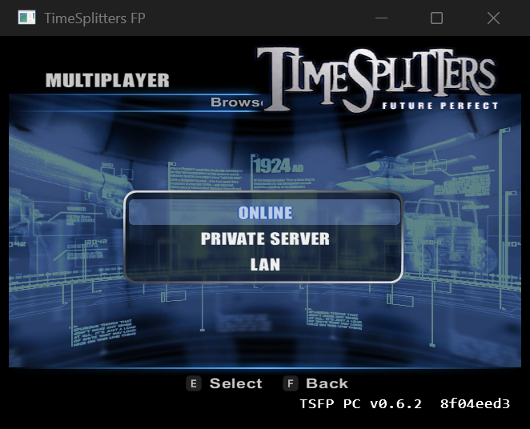
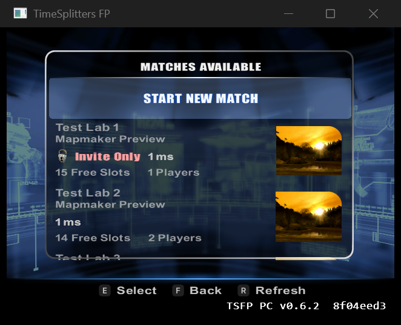
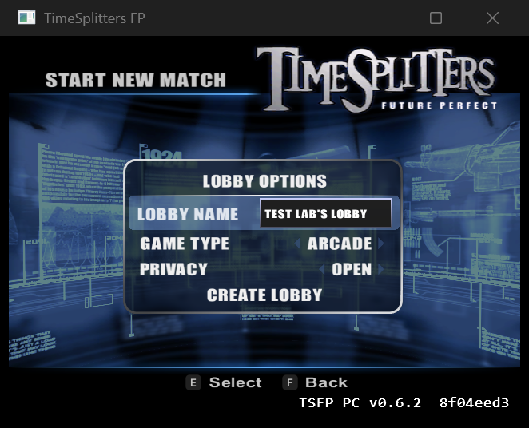
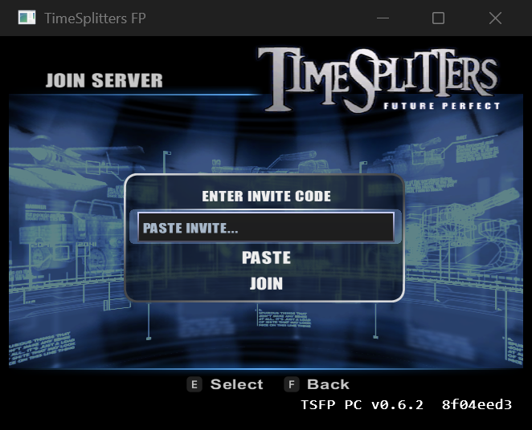

# Multiplayer

Choose **Multiplayer** from the main menu. Hosting and joining now use
the game's own menus; you do not need the separate Online window or a server
script.

Everyone needs the **same game build and matching game data**. A matching version
number alone is not enough for different development builds. Online is still
experimental. These instructions cover builds with the new in-game menus;
older downloads may look different.

## Choose how to play

| Choose | Use it for | Router setup |
| --- | --- | --- |
| **Online** | Matches on the community server. The simplest place to start. | Players do not need port forwarding. |
| **Private Server** | Your own match list, shared with friends by invite. | Only the server owner needs UPnP or manual forwarding. |
| **LAN** | Players on the same local network. | No Internet forwarding; allow the game through the local firewall. |

Online **Arcade** is the normal choice; Story co-op requires a dedicated compatible testing build.

## Play on the community server

### Join a match

1. Choose **Multiplayer > Online**.
2. Select a match under **Matches Available**. Use **Refresh** if your friend's
   match is missing.
3. For **Invite Only**, ask the host for the **lobby code**. Select the match,
   enter or paste that code, then choose **Join**.
4. In the lobby, select **Ready**. The host chooses the settings and starts
   play with **Go**.

*The screenshot uses local example lobbies and response times. Your list will
vary. Invite Only matches are visible, but require their lobby code to join.*

The number ending in **ms** is the community service's response time. Lower is
better, but it is not the full gameplay delay to that match's host. **-- ms**
means no measurement is available. A full match cannot accept another player.

### Host a match

1. Choose **Multiplayer > Online > Start New Match**.
2. Edit the lobby name if you want, leave **Game Type** on **Arcade**, and choose
   **Open** or **Invite Only** under **Privacy**.
3. Choose **Create Lobby**.
4. Choose the map and rules in the lobby's **Options**. Wait for your friends to
   join and select **Ready**, then choose **Go**.

**Open** lets anyone with a compatible build join. **Invite Only** still appears
in the browser, but only people with its lobby code can enter. Select the lobby
code at the bottom to copy it, press **C** on the keyboard, or press the
controller's **right stick**. Share it privately with your friends.

## Play on a private server

A private server gives your group its own match list. Its owner does not have
to host every match: other connected players can create their own lobbies too.

### Start the server

1. Choose **Multiplayer > Private Server > Host a Server**.
2. Wait for the server to start, then choose **Copy** to copy its invite code.
3. Send that **server invite** to your friends and choose **Next** to open the
   match browser.
4. Choose **Start New Match**, set the name and privacy, then **Create Lobby**.
   Your friends can also create matches in this browser.

The game attempts automatic router setup with **UPnP**. If the hosting screen
warns that port mapping is unavailable, forward **TCP 30820** and **UDP 30821**
to the server owner's computer, and allow the game through its firewall. Keep
any existing manual forwards. Guests and other lobby hosts do not need their
own forwards when using this private server's relay.

If your connection uses carrier-grade NAT, forwarding may not work. Use
**Online**, or ask a friend with a reachable connection to run the server.

### Join the server

1. Ask its owner for the **complete server invite**.
2. Choose **Multiplayer > Private Server > Join by Code**.
3. Choose **Paste**, then **Join**.
4. Select a match from that server's browser, or choose **Start New Match**.
   An Invite Only match also needs its separate lobby code.

**Server invite or lobby code?** A server invite opens a private server's match
list. A lobby code unlocks one Invite Only match after you connect to the
correct server. They are not interchangeable. Keep both private.

### Keep the server running

Leaving a lobby keeps your private server running, so you can browse or join
another match. **Returning the server owner to Multiplayer or closing their game
stops the server and disconnects its players.**

Leaving as the host of a private match ends that match. Community Arcade matches
support host migration; private matches do not use that migration system.

## Play on a LAN

1. Connect everyone to the same local network and use matching builds.
2. Choose **Multiplayer > LAN** on each computer.
3. One player chooses **Start New Match**. Others select that match and choose
   **Ready**; the host starts it with **Go**.

Allow the game through your firewall on the private/local network. If a match
does not appear, check that the router is not isolating devices on guest Wi-Fi.
LAN play does not connect to original Xbox consoles or Xbox Live.

## Another round and bots

The host can choose **Return to Lobby** while paused or after a match to keep
the group together for another round. Adjust the lobby's **Options**, have
players select **Ready**, then start again with **Go**.

Use **Bot Set** in the match options to choose or edit the host's bots. Use a
zero-bot set to play without them. Guests cannot edit the host's roster. Bot support remains
experimental; report missing bots, different behaviour between players or crashes.

## If something goes wrong

| Problem | What to try |
| --- | --- |
| Your friend's match is missing | Check that you chose the same community/private server, have matching builds, and selected **Refresh**. |
| An Invite Only code is rejected | Select the correct match and ask its host for the current **lobby code**. Do not paste a server invite into this field. |
| A private server will not connect | Ask its owner to check the hosting warning, firewall and UPnP/manual forwards. Make sure their server is still running. |
| SSL handshake or read timeout | The server did not answer in time. Return to the browser and retry. If it persists, try a private server or LAN and report which server you were using. Keep certificate checks enabled. |
| Refreshing never finishes | Close and reopen the game. Source builds need the game and its Online companion built from the same revision. |
| Players disconnect when the owner leaves | A private server must remain running. Leaving a private match as its host also ends that match. |

When reporting a problem, include your game version, whether you were hosting or
joining, **Online / Private Server / LAN**, the exact error, and whether players
were on different networks. Do not post invite codes or personal connection
details publicly.

Recent network measurements are collected locally; nothing is uploaded
automatically. For a crash, use the launcher's diagnostics to export a report,
review it, then attach it to your report. See the
[crash-report guide](windows-crash-logger.md) for details.

For development builds and technical setup, see
[test profiles](../development/testing-profile.md),
[automatic port mapping](../development/online-upnp.md) and the
[community-service guide](../development/online-relay.md).
