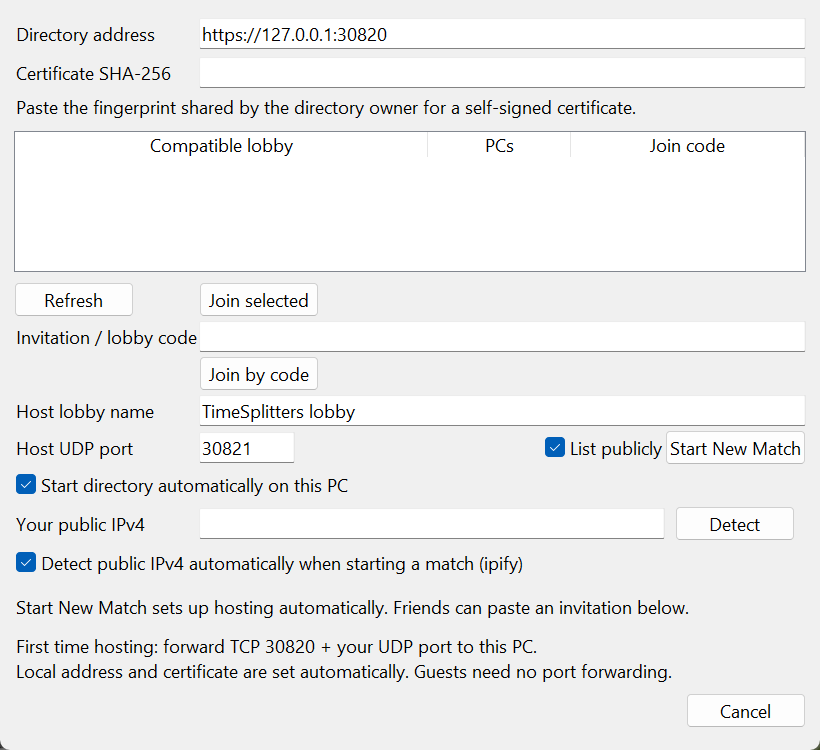
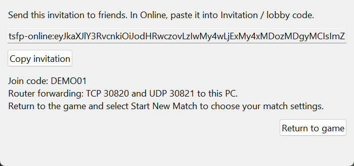
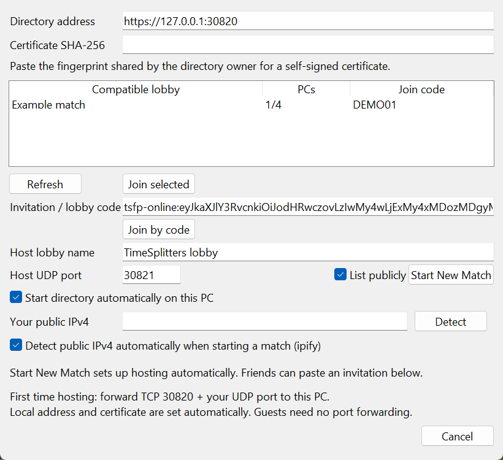

# Online multiplayer

Everyone needs the same game build and matching US Xbox game files. Start the
game from the launcher or **Play.cmd**, then choose **Online / System Link → Online**.
You do not need an account or a paid service.

Native Apple Silicon development builds also include this Online window. Build
matching Windows/Mac source revisions, start the Mac build with
**Play-Native-Mac.command**, and use the same host/join steps below. Allow incoming
connections for the game and its Online companion in the macOS firewall when
hosting. Mac support has passed browser/connection lifecycle tests and a
Windows–Mac transport check; full mixed-platform matches remain unverified.
It is not yet included in a published Mac game release.

The redesigned Online window uses **Play online** for joining and hosting, and
**Directory settings** for advanced connection details. Screenshots below show
the previous layout; the host/join workflow remains the same.

## Host a match

1. **Set up your router once:** forward **TCP 30820** and **UDP 30821** to your
   PC, and allow both through Windows Firewall. Only the host needs to do this.
2. In the Online window, leave **Start directory automatically** and
   automatic public IPv4 detection enabled. Enter a lobby name, then click
   **Start New Match**. Leave the UDP port at **30821** unless you need another.
3. Click **Copy invitation** and send the full invitation to your friends.
4. Click **Return to game**, then select **Start New Match** in the game to
   choose the map and mode.
5. Once your friends have joined and selected **Ready**, select **Go**.

Keep the host's game running during the session. If you choose a different UDP
port, forward that port instead of 30821. The game does not configure your
router or firewall for you.



*Hosting: leave the two automatic options checked, enter a lobby name, and click
Start New Match.*



*Click Copy invitation to share connection details, then Return to game.
This screenshot uses an example invitation; ask your host for a real one.*

## Join a friend

1. Ask the host for the **full invitation**.
2. In the Online window, paste it into **Invitation / lobby code** and click
   **Join by code**. Connection details are filled in automatically.
3. In the game's match list, select the host's match, then select **Ready**.
   The host starts the match.

Guests do not need to forward ports. To browse public lobbies instead, use the
same directory as the host, click **Refresh**, select a lobby, then **Join selected**.
A short join code works only when that directory is already configured.
Set its address and fingerprint on the **Directory settings** tab.



*Joining: paste your friend's full invitation into Invitation / lobby code,
then click Join by code. The lobby and invitation shown here are examples.*

## If you cannot connect

- **Different builds or game data:** everyone must use matching versions and
  the supported US game files.
- **Host does not answer:** check the host's router forwarding and Windows
  Firewall. If the host's connection uses carrier-grade NAT, ask another player
  with a reachable public IPv4 to host. IPv6-only hosting is not supported.
- **Wrong public IP or VPN:** turn off automatic IP detection and enter the
  host's public IPv4 manually. **Detect** refreshes the address.
- **Playing on the same local network:** use **System Link** instead; see below.

Online is experimental. Local two-process matches have reached gameplay;
real internet connections and full-match stability remain unverified.
Campaign co-op is not supported.

## Advanced: shared directory

Skip this section for normal hosting. Automatic hosting starts the connection
service (directory) and configures its certificate for you. It stops when the
host exits, chooses System Link or reopens Online. Public IP detection uses
[ipify](https://www.ipify.org/) with a five-second timeout; it sends no lobby
information, credentials or game data and does not open router ports.

Use a standalone directory only if several hosts need to share one persistent
lobby list. Disable **Start directory automatically** when using it.
Automatic hosting reports an occupied directory port rather than replacing an
existing service.

### Optional standalone directory

One player starts a persistent directory separately. Replace the example with their public IPv4:

```powershell
.\Start-OnlineDirectory.ps1 -PublicAddress '203.0.113.42'
```

The script creates a reusable self-signed TLS certificate under ignored
`private/online-directory`, prints its SHA-256 fingerprint, and runs until stopped.
It uses OpenSSL included with Git for Windows and the workspace's Python
environment. Keep this window open. It makes no certificate store changes.

- Forward **TCP 30820** on the directory player's router to that PC. Friends use
  `https://<directory-public-IP>:30820` and the printed certificate fingerprint.
- On the directory PC use `https://127.0.0.1:30820` and that same fingerprint.
  `-PublicAddress` makes its own game-host registrations advertise the reachable
  public address instead of loopback.
- The game host also forwards **UDP 30821** to their PC and allows it through
  Windows Firewall. The browser can select a different port; forward the same
  number externally and internally. Directory and game host can be the same PC.
  A different game host forwards only its selected UDP port.
- Guests need no forwarding. A host behind carrier-grade NAT needs a reachable
  player to host instead. IPv6-only hosting is not implemented.

Choose **Online / System Link > Online** in the game, open **Directory settings**,
and enter the directory address and certificate fingerprint. These non-secret preferences are saved in
ignored `config/pc-online.json`.

To host, enter a name and UDP port, select **List publicly** or leave it private,
and click **Start New Match**, with automatic directory hosting disabled.
Share the displayed join code for a private lobby.
Return to the game and select **Start New Match**.

Friends click **Refresh**, select a compatible lobby and **Join selected**, or
enter a private code and click **Join by code**. The bridge requires an
authenticated reply from the host before opening the game's match list. Select
the host's match there and Ready; the host selects Go. Browser counts represent
connected PCs; the game's own lobby shows and limits actual players.

The browser/bridge companion has no console and exits when the game closes,
including after a crash. Choosing Online again closes the previous connection.
Choosing System Link disconnects it and uses LAN transport. Cancel returns to the
game without connecting. Keep the directory running during online sessions;
registrations expire after 90 seconds without a heartbeat. No database or copies
of game assets are created. Hosts sharing a router need separate UDP forwards;
devices on that LAN can use System Link instead of relying on router hairpin NAT.

## Try System Link on a LAN

Build the same source and game content on both PCs, then run in PowerShell:

```powershell
.\tsfp.ps1 Build
.\tsfp.ps1 Run -SystemLink
```

Select **Online / System Link > System Link**. One player selects **Start New
Match**; the other selects that match, then Ready. The host starts the match.
The native transport uses UDP 1000 (gameplay), 3000 (session information), and
9999 (discovery). Allow the game through Windows Firewall on the private LAN.

Active PC matches sample outgoing movement once per 60 Hz guest tick. The
original Xbox send gate waited seven ticks (about 117 ms), which delayed rapid
keyboard strafe reversals and caused remote players to snap back to corrected
positions (issue #20). The PC gate applies to both Online and System Link;
the game clock, network epoch, heartbeat/timeout calculations and input encoding
remain unchanged. Full movement state is refreshed at least every three match
ticks (20 Hz), even when keys remain held or only the raw mouse camera changes.
The original controller-byte change detector could otherwise leave prediction
uncorrected for about a second after independent frame stalls. This increases
movement traffic; it does not eliminate host frame-rate drops. Both peers need
the updated matching build. Two-instance loopback measurements are recorded in
[docs/project/STATUS.md](../project/STATUS.md#multiplayer-strafe-updates-issue-20--2026-10-16);
physical-controller, cross-machine and WAN checks remain pending.

If LAN broadcasts do not reach the other PC, explicitly name its LAN IPv4:

```powershell
.\tsfp.ps1 Run -SystemLink -Peers '192.168.1.25'
```

`-Peers` duplicates discovery broadcasts to the supplied addresses. It does not
solve NAT, translate addresses embedded in Xbox session data, or make internet
play ready. Selecting System Link enables native LAN transport.
There is no Xbox console interoperability or Xbox Live emulation.

## Compatibility

Build generates `build/windows/generated/network-identity.json` and a compiled
SHA-256 identity from the protocol, native source, runtime source, lifted game
code, patches, and game data. Paths are relative and source line endings are
normalized. Online companion source is included too. User settings, saves,
diagnostic metadata and external texture
packs are excluded. Other source changes are conservatively incompatible.
Game content means `default.xbe` and the `pak`/`xmv` asset trees, matching the
folder importer. Xbox dashboard updaters and generated `CACHE` files are excluded;
creating or changing runtime cache files does not invalidate multiplayer.

Every discovery and gameplay datagram carries the compiled identity. Traffic
with a different identity, an unknown header, or no header is discarded before
the game receives it. This covers connections that bypass the browser.
The launcher also verifies the executable against a successful-build stamp,
hashes game content before a System Link launch, and refuses content changed
since the build; rebuild after editing game data. A failed build cannot authorize
an old executable against a new manifest. Launching the
EXE directly bypasses that launcher check. Online also checks game content and
compares the running executable's compiled identity with the manifest on opening.

The directory only returns public lobbies matching the requested identity.
Looking up an incompatible lobby by its private code returns HTTP 409. This is
compatibility enforcement for cooperating builds, not authentication, encryption,
or protection against a deliberately modified client.

## Online transport

### Latency display and build version

Open **PC Settings > Debug** (F12) and enable **Show network latency** to display
round-trip time in milliseconds. Online guests measure their host; hosts and LAN
players show the highest fresh peer RTT. The Debug window also shows the number
of peers measured. Samples refresh about once a second and expire after five
seconds without a reply. Offline and waiting states are labelled; the lobby
directory response time is not used as gameplay latency. Online probes are
authenticated and replay-checked with the normal room credentials. LAN probes
check build identity and the outstanding reply nonce. Control packets stay out
of the original game's packet decoder.

A persistent lower-right watermark shows the PC version from `VERSION` and the
first eight characters of the multiplayer build identity. It remains visible
when Debug counters are off, including interpolated frames and fullscreen.

Online presents `10.254.0.0/24` addresses to the title, preserving addresses inside
Xbox session data across different networks. Game sockets talk to their own
bridge on loopback using a random local token. Physical socket ports are
ephemeral, allowing two instances on the same PC without port conflicts.

Guests open an outbound UDP path to the host. The host delivers packets addressed
to itself and relays guest-to-guest traffic. This is host-routed multiplayer; it
needs no third-party relay or direct guest-to-guest hole punching. Relayed traffic
consumes the host's bandwidth.

Directory v2 provides filtered listing, private/public registration, code joining,
rosters, peer leases and removal. Credentials travel over HTTPS. Each guest has
a separate key shared only with the host. UDP uses HMAC-SHA256 authentication,
room/build identities and sequence numbers to reject replayed, wrongly signed,
wrong-room and wrong-build packets. Game payloads are authenticated but not
encrypted. The host remains trusted; this is not an anti-cheat system.

The service retains v1 for the earlier foundation; Online uses v2. Requests,
concurrent connections, room counts, packet sizes and receive work are bounded.
Do not put it behind a proxy that hides caller IPs: remote game-host addresses
come from the TCP connection. HTTPS uses normal certificate verification unless
an exact fingerprint is supplied; it is checked before credentials are sent.
The client accepts HTTP only on localhost for development.

Remaining validation includes real internet routing, different NAT behavior,
disconnect/rejoin in a full match and sustained play across modes. Packaging
The release script bundles Python/Tk, the companion, and certificate-generation
dependencies under `Support`. No separate Python, Git, or OpenSSL installation
is required by players. Portable Online preferences and hosting certificates live
under `Settings`, and transient handshakes/diagnostics under `Logs/Online`.
Keep the entire extracted package together, and preserve `Data`, `Settings`, and
`Saves` when upgrading. Both players should use the same package and game data.

## Validation and storage

### Experimental bot setup (issue #25 development branch)

The host can open **Options** from its multiplayer lobby, continue through
level/mode selection to match settings. **BOT SET** appears below **WEAPON SET**,
using Arcade's original selector and edit action. Choose a set with left/right,
or use the edit action to change characters, teams, skills and enabled bots.
Return to match settings and confirm the choices before starting.
Guests cannot change the host's roster. The prototype uses at most ten bots and
never exceeds sixteen human/bot character slots, preserving existing human IDs.

Opening host match settings enables experimental roster loading for that
session. Select a zero-bot set to play without bots.
Use matching builds and disposable test saves; `Test-SystemLink.ps1` provides
two isolated local instances as described below. Start with one or two bots.
Check that both PCs see the same roster, movement, attacks, damage, deaths,
respawns and scores, including a rematch and disconnect. Test LAN first, then
the Online bridge.

This development build now sends host-owned bot state to guests and adds bot
references to combat events. Both peers must use the same updated build; the
compatibility identity rejects older versions. Two-instance LAN checks have
confirmed guest-visible bot models and movement. Full combat, lifecycle and
Online acceptance remain recorded separately in `docs/project/STATUS.md`; this is still
experimental support. Report missing bots, different behavior between peers or
crashes with the host/client logs. Development
details and outstanding work are in [the investigation](../analysis/online-bots-investigation.md).

Launch both local test instances from the repository folder:

```powershell
.\Test-SystemLink.ps1
```

The script verifies the existing build, launches a host and client with separate
test saves and display settings, and waits until both games close before recycling
their temporary virtual disks automatically. Leave its PowerShell window open
until cleanup finishes. Test profiles are retained for the next run; logs are
overwritten in each role's `interactive.out` and `interactive.err`. The launcher
restores the calling shell's environment and prevents overlapping test sessions.
It uses the fixed test controls, so personal bindings and settings are preserved.
In both windows choose **Online / System Link > System Link**. Host a new match
in the first window, join and Ready in the second, then select Go on the host.

Native tests cover UDP round trips, default-protocol sockets used by discovery,
XNADDR/key mapping, source ports, invalid guest pointers, and incompatible/raw
packet rejection. Python tests cover deterministic identities, changed game and
runtime data, directory filtering, private codes, owner authorization, full
lobbies, heartbeat compatibility, and expiry.

Online native tests also check bridge registration, tokens and virtual source
routing. Python tests use real sockets for the directory, handshake, three-PC
relay, broadcast routing, credential rejection and version filtering. The local
HTTPS game run exercised the Online-menu-to-gameplay path and certificate
pinning; a wrong certificate fingerprint was rejected.

`TSFP_ONLINE_TEST_COMMAND` enables automated host/browse/code actions only from a
file inside `private/network-validation`. `TSFP_ONLINE_SETTINGS` redirects UI
preferences for isolated tests. Neither is needed for normal play.

Manual two-process validation uses `private/network-validation/host` and `client`
with separate saves and loopback addresses 127.0.0.2 and 127.0.0.3. It reuses the
same game data and build. `TSFP_PC_INPUT_STATE` is an opt-in test input file with
`<virtual-key-number> <0-or-1>`, updated atomically; it permits background input
without changing desktop focus. Never point either test process at personal saves.

After both processes stop, run `tools/network/cleanup-network-tests.ps1`. It recycles only
the six known disposable `Partition*.img` files per test save directory, rejects
reparse points and out-of-root paths, and preserves test profiles and evidence.
